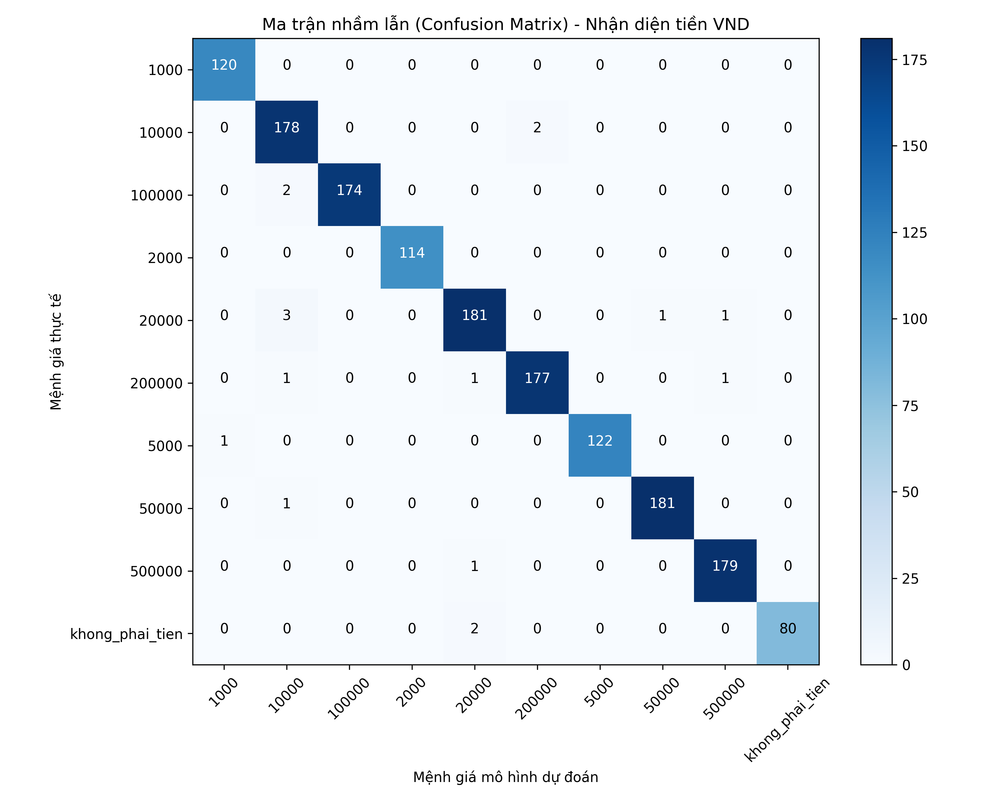

# 💵 Nhận diện Tiền VNĐ cho Trạm Quyên Góp Minh Bạch (MobileNetV3-Small – ONNX)

Module huấn luyện, đánh giá và đóng gói mô hình học sâu **MobileNetV3-Small** phân loại **9 mệnh giá tiền Việt Nam** (`1.000đ` – `500.000đ`) và lớp **`khong_phai_tien`**, phục vụ đồ án Thị giác Máy tính theo **Hướng 3: Trạm quyên góp thiện nguyện minh bạch thời gian thực** (chạy mượt trên CPU qua ONNX, tích hợp cùng bộ tách tờ & vạch khe thả tiền OpenCV và giao diện PySide6).

---

## 📦 Sản phẩm bàn giao cho nhóm

| File | Kích thước | Mô tả & Mục đích sử dụng |
| :--- | :---: | :--- |
| [`models/currency_classifier_v1.onnx`](models/currency_classifier_v1.onnx) | ~6.13 MB | **Mô hình triển khai chính (khuyến nghị)** — xuất ONNX opset 13, hỗ trợ dynamic batch, chạy nhanh trên CPU qua `onnxruntime` hoặc `cv2.dnn` (không cần cài PyTorch). |
| [`models/best_mobilenetv3.pth`](models/best_mobilenetv3.pth) | ~6.25 MB | Trọng số PyTorch tốt nhất (đạt đỉnh tại GĐ2 – Epoch 14/15). |
| [`models/confusion_matrix.png`](models/confusion_matrix.png) | ~252 KB | Biểu đồ ma trận nhầm lẫn trên tập Validation (1.523 ảnh, 300 DPI) dùng cho báo cáo & slide. |
| [`train_mobilenetv3.ipynb`](train_mobilenetv3.ipynb) | — | Notebook huấn luyện trên Google Colab (đã ẩn API key Roboflow và đồng bộ Cell 7 với `CurrencyClassifier` Hướng 3). |
| [`test_models.ipynb`](test_models.ipynb) | — | Notebook kiểm thử cục bộ (đánh giá PyTorch trên tập Test, soi ảnh lỗi, Stress Test và kiểm thử triển khai `.onnx` Hướng 3). |
| [`requirements.txt`](requirements.txt) | — | Danh sách thư viện môi trường Python 3.12 cục bộ. |

> **Lưu ý:** Các thư mục ảnh dữ liệu lớn (`data/`, `data_test/`, `raw_data_*`) và môi trường ảo (`.venv/`) đã được loại trừ trong [`.gitignore`](.gitignore) để giữ repository gọn nhẹ.

---

## 📊 Dữ liệu Huấn luyện & Kiểm thử (`data_v1`)

Dữ liệu được tổng hợp từ 2 bộ dữ liệu Roboflow (cắt sạch từng tờ tiền theo tọa độ nhãn YOLO và chuẩn hóa về kích thước **`224 × 224`**, đồng thời tạo thêm mẫu nền `khong_phai_tien` và bổ sung ảnh đời thực khi kiểm thử):

* **Nguồn 1 (`ds1`):** `first-qkz37/vietnamese-currency-lgi9i` (v6) — 9 mệnh giá (`1.000đ` – `500.000đ`), trích xuất 12.961 ảnh tiền + mẫu nền.
* **Nguồn 2 (`ds2`):** `tran-minh-nghia/vietnam-money-recognize-dy4cd-iddjh` (v1) — 6 mệnh giá polymer (`10.000đ` – `500.000đ`), trích xuất 1.922 ảnh tiền + mẫu nền.

| Lớp nhãn (`CLASS_NAMES`) | Mệnh giá hiển thị | Train | Val | Test | Tổng |
| :--- | :--- | :---: | :---: | :---: | :---: |
| `1000` | 1.000 VNĐ | 1.236 | 120 | 68 | 1.424 |
| `10000` | 10.000 VNĐ | 1.481 | 180 | 81 | 1.742 |
| `100000` | 100.000 VNĐ | 1.501 | 176 | 98 | 1.775 |
| `2000` | 2.000 VNĐ | 1.293 | 114 | 60 | 1.467 |
| `20000` | 20.000 VNĐ | 1.442 | 186 | 96 | 1.724 |
| `200000` | 200.000 VNĐ | 1.474 | 180 | 94 | 1.748 |
| `5000` | 5.000 VNĐ | 1.248 | 123 | 68 | 1.439 |
| `50000` | 50.000 VNĐ | 1.544 | 182 | 87 | 1.813 |
| `500000` | 500.000 VNĐ | 1.481 | 180 | 90 | 1.751 |
| `khong_phai_tien` | Không phải tiền | 291 | 82 | 71* | 444 |
| **Tổng cộng** | **10 lớp** | **12.991** | **1.523** | **813** | **15.327** |

> \* *71 ảnh `khong_phai_tien` ở tập Test gồm 41 ảnh nền tách từ dataset và 30 ảnh đồ vật đời thực tự chụp bằng điện thoại (bàn học, chai nước, quạt, màn hình, phụ kiện...).*

---

## 🧠 Kiến trúc & Quy trình Huấn luyện

Huấn luyện trên **Google Colab (GPU)** với chiến lược **Transfer Learning 2 giai đoạn**:

* **Kiến trúc:** `MobileNetV3-Small` (trọng số khởi tạo `IMAGENET1K_V1`), thay lớp cuối `classifier[3]` thành `nn.Linear(1024, 10)`.
* **Xử lý mất cân bằng lớp:** `WeightedRandomSampler` theo trọng số nghịch đảo tần suất từng lớp (`1 / count`).
* **Hàm mất mát:** `CrossEntropyLoss(label_smoothing=0.1)`.
* **Optimizer & Batch Size:** `AdamW`, `batch_size = 32`.
* **Data Augmentation (Albumentations — chỉ trên tập Train):**
  * `Rotate(±10°, p=0.5)`, `RandomRotate90(p=0.5)`
  * `RandomBrightnessContrast(brightness=0.15, contrast=0.15, p=0.5)`
  * `MotionBlur(limit=3, p=0.2)`, `GaussNoise(p=0.2)`, `RandomShadow(p=0.2)`
  * Chuẩn hóa ImageNet: `mean = (0.485, 0.456, 0.406)`, `std = (0.229, 0.224, 0.225)`
* **Tiến trình 2 giai đoạn:**
  1. **Giai đoạn 1 (Warm-up – 5 epochs):** Đóng băng `model.features`, huấn luyện `model.classifier` với `lr = 1e-3` → Val Loss `0.7414`, Val Acc **92.38%**.
  2. **Giai đoạn 2 (Fine-tuning – 15 epochs):** Mở khóa toàn bộ mạng, `lr = 1e-4`, lưu checkpoint tốt nhất theo `val_loss` (`Early Stopping patience = 5`). Đạt đỉnh tại **Epoch 14/15**:
     * **Train:** Loss `0.5851` | Accuracy **98.11%**
     * **Validation:** Loss `0.5512` | Accuracy **98.88%**

---

## 📈 Kết quả Đánh giá

### 1. Tập Validation (1.523 ảnh — trên Google Colab)
* **Accuracy:** **98.88%** (1.506 / 1.523) | **Macro F1:** **98.97%** | **Weighted F1:** **98.89%**
* Lớp `khong_phai_tien`: Precision **100.00%** | Recall **97.56%** | F1 **98.77%** (80/82 ảnh).



### 2. Tập Test độc lập (813 ảnh — chạy cục bộ qua `test_models.ipynb`)
* **Accuracy tổng (PyTorch):** **98.03%** (797 / 813) — độ lệch Val vs Test chỉ **0.85%** (không bị overfitting).
* **Độ tin cậy trung bình:** Khi đoán đúng **90.55%** | Khi đoán sai **50.39%**.
* **Kiểm tra ảnh hoàn toàn chưa từng thấy (loại trừ các ảnh chung gốc Roboflow):** **97.99%** (584 / 596 ảnh tiền).

| Lớp | Số ảnh | Precision | Recall | F1-Score | Conf TB |
| :--- | :---: | :---: | :---: | :---: | :---: |
| `1000` | 68 | 100.00% | 100.00% | 100.00% | 90.88% |
| `10000` | 81 | 96.34% | 97.53% | 96.93% | 92.00% |
| `100000` | 98 | 97.96% | 97.96% | 97.96% | 91.34% |
| `2000` | 60 | 100.00% | 100.00% | 100.00% | 93.86% |
| `20000` | 96 | 94.90% | 96.88% | 95.88% | 87.25% |
| `200000` | 94 | 98.92% | 97.87% | 98.40% | 91.53% |
| `5000` | 68 | 98.55% | 100.00% | 99.27% | 92.35% |
| `50000` | 87 | 98.86% | 100.00% | 99.43% | 91.58% |
| `500000` | 90 | 97.75% | 96.67% | 97.21% | 89.94% |
| `khong_phai_tien` | 71 | 98.53% | 94.37% | 96.40% | 76.63% |

### 3. Stress Test độ ổn định (200 ảnh mẫu — 20 ảnh/lớp)

| Kịch bản mô phỏng camera | Accuracy | Độ tin cậy TB |
| :--- | :---: | :---: |
| Ảnh gốc | **97.00%** | 88.20% |
| Thiếu sáng (`0.5×`) | **99.00%** | 81.87% |
| Xoay `+15°` / `90°` / Lật gương ngang | **96.50% – 97.00%** | 86.91% – 88.06% |
| Làm mờ Gaussian (`r=2`) / Cắt mất 25% viền | **95.00% – 95.50%** | 81.55% – 85.54% |
| Chói sáng (`1.5×`) | **85.00%** | 73.69% |

### 4. Kiểm thử triển khai ONNX theo Hướng 3 (ngưỡng `0.75` — Cell 5 trong `test_models.ipynb`)
* **Độ chính xác thô `.onnx` (argmax trên 813 ảnh Test):** **98.15%** (`798 / 813`).
* **Trên 742 ảnh tiền thật tại ngưỡng `0.75`:** Chốt đúng **706 ảnh (95.15%)**, chỉ **1 ảnh (0.13%)** nhầm sang mệnh giá khác, **34 ảnh** được đẩy sang `khong_chac_chan` (nhắc vuốt phẳng) và **1 ảnh** bị xếp vào `khong_phai_tien`.
* **Trên 71 ảnh không phải tiền tại ngưỡng `0.75`:** Chặn tổng cộng **70 / 71 ảnh (98.59%)** (`68` ảnh chặn đúng nhãn `khong_phai_tien` + `2` ảnh chặn dưới ngưỡng `khong_chac_chan`), chỉ `1` ảnh lọt.
* **Kiểm chứng gộp đa khung hình (`predict_multi_frame`):** Ảnh `50.000đ` bị làm mờ Gaussian nặng `(31×31)` khi đoán đơn lẻ rớt về `khong_chac_chan (66.31%)`, nhưng khi gộp với 3 khung sắc nét (`[3 nét + 1 mờ]`) vẫn chốt đúng **`50000` (84.50%)**.

---

## 🔌 Hướng dẫn Tích hợp cho Nhóm (Hợp đồng Module — Hướng 3)

### 1. Thứ tự 10 nhãn BẮT BUỘC (theo đúng thứ tự `ImageFolder` lúc train)
```python
CLASS_NAMES = [
    '1000', '10000', '100000', '2000', '20000',
    '200000', '5000', '50000', '500000', 'khong_phai_tien'
]
```
> ⚠️ **Tuyệt đối không tự sắp xếp lại theo thứ tự tăng dần số tiền** (`1000`, `2000`, `5000`...) vì sẽ làm lệch hoàn toàn chỉ số dự đoán của mô hình!

### 2. Phân tách 3 trạng thái đầu ra cho Trạm quyên góp minh bạch
* **Đầu vào:** Ảnh **BGR kích thước `224 × 224`** (`numpy.ndarray` từ OpenCV, đã cắt sạch tờ tiền — **không vẽ khung viền đè lên ảnh trước khi dự đoán**).
* **Đầu ra `(label, confidence)`:**

| Giá trị `label` | Ý nghĩa trong Hướng 3 | Hành động gợi ý trên Giao diện (TV1) |
| :--- | :--- | :--- |
| `'1000'` … `'500000'` | Tiền hợp lệ đạt ngưỡng tin cậy (`>= 0.75`) | Khóa mệnh giá, đợi tâm tờ tiền đi qua vạch khe thả tiền (`Virtual Tripwire`) rồi cộng quỹ & phát lời cảm ơn. |
| `'khong_phai_tien'` | Vật lạ, bàn tay, giấy trắng, hóa đơn, thẻ sinh viên | Từ chối ngay, không cộng tiền dù đi qua khe hộp; nhắc lấy vật lạ ra khỏi khay. |
| `'khong_chac_chan'` | Là tiền nhưng bị gấp mép, mờ hoặc lóa dưới ngưỡng | Nhắc người quyên góp vuốt phẳng đặt lại (**không** cho người dùng công cộng tự bấm sửa mệnh giá ngoài màn hình chính). |

### 3. Code mẫu tích hợp ONNX (hỗ trợ `onnxruntime` CPU & tự fallback `cv2.dnn`)
> Nhóm có thể copy trực tiếp lớp `CurrencyClassifier` dưới đây (đồng bộ với Cell 7 của [`train_mobilenetv3.ipynb`](train_mobilenetv3.ipynb) và Cell 5 của [`test_models.ipynb`](test_models.ipynb)):

```python
import cv2
import numpy as np

CLASS_NAMES = [
    '1000', '10000', '100000', '2000', '20000',
    '200000', '5000', '50000', '500000', 'khong_phai_tien'
]


class CurrencyClassifier:
    def __init__(self, model_path="models/currency_classifier_v1.onnx", conf_threshold=0.75):
        self.class_names = list(CLASS_NAMES)
        self.conf_threshold = float(conf_threshold)
        self.mean = np.array([0.485, 0.456, 0.406], dtype=np.float32)
        self.std = np.array([0.229, 0.224, 0.225], dtype=np.float32)
        self.session = None
        self.net = None

        try:
            import onnxruntime as ort
            self.session = ort.InferenceSession(model_path, providers=["CPUExecutionProvider"])
            self.input_name = self.session.get_inputs()[0].name
        except ImportError:
            self.net = cv2.dnn.readNetFromONNX(model_path)

    def _infer_probs(self, img_bgr):
        img_224 = cv2.resize(img_bgr, (224, 224))
        img_rgb = cv2.cvtColor(img_224, cv2.COLOR_BGR2RGB).astype(np.float32) / 255.0
        img_norm = (img_rgb - self.mean) / self.std
        tensor_in = np.ascontiguousarray(np.transpose(img_norm, (2, 0, 1))[np.newaxis, ...], dtype=np.float32)

        if self.session is not None:
            logits = self.session.run(None, {self.input_name: tensor_in})[0][0]
        else:
            self.net.setInput(tensor_in)
            logits = self.net.forward()[0]

        logits = np.asarray(logits, dtype=np.float32).reshape(-1)
        exp_logits = np.exp(logits - np.max(logits))
        return exp_logits / np.sum(exp_logits)

    def _decide(self, probs):
        best_idx = int(np.argmax(probs))
        confidence = float(probs[best_idx])
        label = self.class_names[best_idx]

        if label == "khong_phai_tien":
            return "khong_phai_tien", confidence
        if confidence < self.conf_threshold:
            return "khong_chac_chan", confidence
        return label, confidence

    def predict(self, img_bgr):
        return self._decide(self._infer_probs(img_bgr))

    def predict_multi_frame(self, imgs_bgr):
        """Gộp xác suất trên 3-5 khung hình liên tiếp (Temporal Softmax Averaging)."""
        if not imgs_bgr:
            raise ValueError("Danh sách ảnh đầu vào cho predict_multi_frame không được rỗng")
        avg_probs = np.mean([self._infer_probs(im) for im in imgs_bgr], axis=0)
        return self._decide(avg_probs)
```

### 4. Phối hợp ghép nối nhanh theo từng thành viên (Hướng 3)
* **TV3 (OpenCV & Khung phần cứng):** Trả thêm tọa độ tâm `(cx, cy)` kèm ảnh cắt `224×224`, kiểm tra tờ tiền đứng yên (~`0.3–0.5s`) rồi gọi `predict_multi_frame(...)`, đồng thời đặt vạch kiểm duyệt khe thả tiền (`Virtual Tripwire`) để chỉ xác nhận giao dịch khi tờ tiền đi qua khe hộp và rời khay (chặn hành vi đặt tiền rồi rút về).
* **TV1 (Giao diện PySide6):** Hiển thị tiến độ mục tiêu chiến dịch, bảng sao kê trực tiếp, phát âm thanh cảm ơn khi nhận xác nhận hợp lệ và **không** cho người dùng công cộng tự sửa mệnh giá khi gặp `khong_chac_chan`.
* **TV4 (Lưu trữ & Kiểm thử):** Ghi nhật ký sao kê (`CSV`/`SQLite`) kèm ảnh bằng chứng `224×224` khi giao dịch thành công; kiểm thử thêm các tình huống thả tiền bình thường, đặt rồi rút tay về, đưa vật lạ (thẻ, giấy trắng, tay) và đối soát tổng quỹ với tiền thật trong hộp.

### 5. Khuyến nghị cấu hình ngưỡng khi chạy Webcam thực tế
* **Nên đặt `conf_threshold = 0.70` – `0.75` (không nên đặt `0.90`):** Do mô hình dùng `label_smoothing = 0.1`, xác suất cực đại tự nhiên của các dự đoán đúng nằm quanh mức **`~91%`**. Ở ngưỡng `0.75` kết hợp `predict_multi_frame`, mô hình chặn tốt vật lạ mà không làm rớt oan tiền thật bị cũ hoặc hơi nhăn.

---

## ⚙️ Cài đặt Môi trường cục bộ

> **Yêu cầu:** Python **3.12** (tránh dùng Python 3.14 do chưa tương thích đầy đủ với PyTorch/OpenCV).

```powershell
# 1. Tạo và kích hoạt môi trường ảo (Windows PowerShell)
python -m venv .venv
.\.venv\Scripts\Activate.ps1

# 2A. Nếu chỉ chạy triển khai nhẹ (ONNX + OpenCV, không cần PyTorch)
pip install opencv-python numpy onnxruntime pillow

# 2B. Hoặc cài đầy đủ toàn bộ môi trường (bao gồm PyTorch để chạy lại notebook test_models.ipynb)
pip install -r requirements.txt
```

---

## 📝 Hạn chế & Hướng phát triển (v2)
1. **Ánh sáng chói (`1.5×`):** Tiền polymer dễ bị lóa dưới đèn mạnh làm độ chính xác tụt về 85% — bản v2 nên tăng biên độ `brightness_limit` lên `0.35–0.45` khi augmentation.
2. **Dữ liệu lớp `khong_phai_tien` & tiền thật trên khay LED thật (v2):** Khi lắp xong hộp quyên góp và đèn LED, chụp bổ sung ảnh bàn tay đẩy tiền, thẻ sinh viên, hóa đơn gấp, giấy trắng và tiền thật (đặc biệt cặp `20.000đ`/`500.000đ`, `10.000đ`/`200.000đ`) trên khay đen thật để fine-tune nhẹ bản `v2`.
